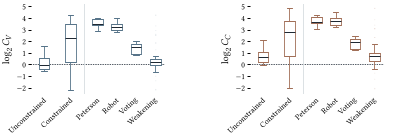
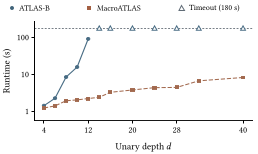
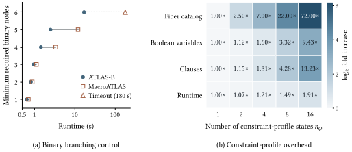

# Experimental results

The final manuscript is the reference for this directory. All numbers below are
recomputed by `python3 scripts/check_results.py`; full-precision summaries are
in [summary/](summary/). Missing values remain missing.

## Paper-to-file map

| Manuscript item | Frozen measurements | Presentation |
| :--- | :--- | :--- |
| Table 1, RQ1 | [Small SMT comparison](raw/rq1_small_smt.csv); [benchmark SMT comparison](raw/rq1_benchmark_smt.csv) | [Correctness summary](summary/rq1.csv) |
| Table 2 and Figure 2, RQ2 | [Translation observations](raw/rq2_translation.csv) | [Group summary](summary/rq2.csv); [unique paired ratios](summary/rq2_observations.csv); [figure](figures/rq2-encoding-ratios.svg) |
| Table 3, RQ3 | [Performance observations](raw/rq3_performance.csv) | [Performance summary](summary/rq3.csv); [paired runtime statistics](summary/rq3_paired_runtime.csv) |
| Figure 3, RQ4 | [Certified unary observations](raw/rq4_unary.csv) | [Plot data](summary/rq4.csv); [figure](figures/rq4-scalability.svg) |
| Figure 4, Discussion | [Certified controls](discussion/certified_controls.csv) | [Plot data](discussion/plot_data.csv); [figure](figures/discussion-controls.svg) |

The manuscript's Figure 1 is a conceptual illustration, not a result derived
from experimental CSVs.

The exact final-manuscript LaTeX tables are retained in [tables/](tables/):
`rq1_correctness.tex`, `rq2_encoding.tex`, and `rq3_performance.tex`. They use
`booktabs` and can be embedded in the manuscript without introducing a separate
report layout.

## RQ1: correctness

| Setting | Jointly decisive status agreements | SAT optimum agreements |
| :--- | ---: | ---: |
| Small instances | 1,000/1,000 | 819/819 |
| Benchmark instances | 393/393 | 384/384 |

The benchmark SMT oracle returns 457 OPTIMAL, 32 UNSAT, and 134 TIMEOUT outcomes.
Only the 393 jointly decisive Oracle/MacroATLAS cases contribute to the second
row. The historical ATLAS-B comparison columns in the evidence are not a
substitute for the independent SMT comparison in the final paper.

## RQ2: translation and encoding size

The numerator is ATLAS-B and the denominator is MacroATLAS. A positive log2 ratio
means the MacroATLAS encoding is smaller. There are 573 unique complete pairs:
459 unconstrained and 114 constrained. Translation succeeds for ATLAS-B on
573/623 inputs and for MacroATLAS on 618/623 inputs. MacroATLAS has fewer variables
on 311 paired inputs and fewer clauses on 563 paired inputs.

Both algorithm rows repeat the paired ratios in the raw CSV. The analysis first
pairs by task, checks both translation statuses, and recomputes ratios from the
actual backend counts. No unpaired observation enters a ratio distribution.

## RQ3: solving performance

| Group | Method | SAT | UNSAT | Timeout | Error | Solved | PAR-2 mean (s) |
| :--- | :--- | ---: | ---: | ---: | ---: | ---: | ---: |
| b=2 | ATLAS-B | 316 | 3 | 251 | 14 | 319 | 177.59 |
| b=2 | MacroATLAS | 345 | 9 | 230 | 0 | 354 | 158.64 |
| b=3 | ATLAS-B | 27 | 0 | 12 | 0 | 27 | 120.10 |
| b=3 | MacroATLAS | 39 | 0 | 0 | 0 | 39 | 23.97 |
| Overall | ATLAS-B | 343 | 3 | 263 | 14 | 346 | 173.99 |
| Overall | MacroATLAS | 384 | 9 | 230 | 0 | 393 | 150.21 |

Solved means SAT or UNSAT within the deadline. PAR-2 uses observed external wall
time for solved inputs and 360 seconds for TIMEOUT/ERROR, averaged over all
instances. On the 331 jointly solved cases, the ATLAS-B/MacroATLAS runtime ratio
has median 1.25 and geometric mean 1.22. No PAR-2 total or memory-based conclusion
is added to the result presentation.

## RQ4: unary structural growth

The 12 certified depths range from 4 to 40. ATLAS-B returns SAT on 5 and times
out on 7; MacroATLAS returns SAT on all 12. The open markers on the 180-second
boundary indicate censored observations, not completed runs. The stored runtime
values and statuses are retained separately in the plot data.

## Discussion controls

These are the other 11 cases in the 23-case certified set: six binary-growth
inputs and five neutral-profile inputs. They are included because the final
paper uses them in its discussion. The earlier 30+13 exploratory instances are
not part of this artifact's reported result set.

## Evidence and data dictionary

| Evidence | Contents |
| :--- | :--- |
| `evidence/benchmark_sat_outputs.jsonl` | 727 final SAT formulas and their archived verification records (343 ATLAS-B, 384 MacroATLAS) |
| `evidence/constraints/` | English per-profile and per-case audit of preserved input constraints; exact constraint texts |
| `evidence/oracle/small_smt_evidence.tar.gz` | Small-case exact-size SMT queries, records, witnesses, and final oracle results |
| `evidence/oracle/final-size-checks.csv` | Per-size checks underlying final benchmark oracle outcomes |
| `evidence/oracle/actual-attempts.csv` | Recorded benchmark oracle attempts, including interrupted attempts |
| `evidence/oracle/attempt-size-checks.csv` | Checks from all recorded attempts |
| `evidence/oracle/campaigns.csv` | Actual campaign deadlines and memory limits |
| `evidence/source_integrity.json` | Original and curated source/data hashes |

Raw CSVs retain their original field names for traceability. `task` is the stable
instance identifier; `B` is the expanded-node budget and `b` the binary-node
budget. `totalSec` is measured external wall time; `par2Sec` is the per-instance
penalized value. `vars` and `backendTotalClauses` are the backend encoding counts.
`objectivePrimary` is retained edges for repair; `objectiveSecondary` is expanded
DAG size. Blank numeric fields mean unavailable or not applicable.

The preserved raw tables also contain diagnostic columns not used in the paper's
tables or plots. Scripts select the documented fields rather than deriving new
claims from those diagnostics. See [reproduction qualifications](../REPRODUCING.md#historical-evidence-qualifications)
for the distinction between archived measurements and fresh replay.
